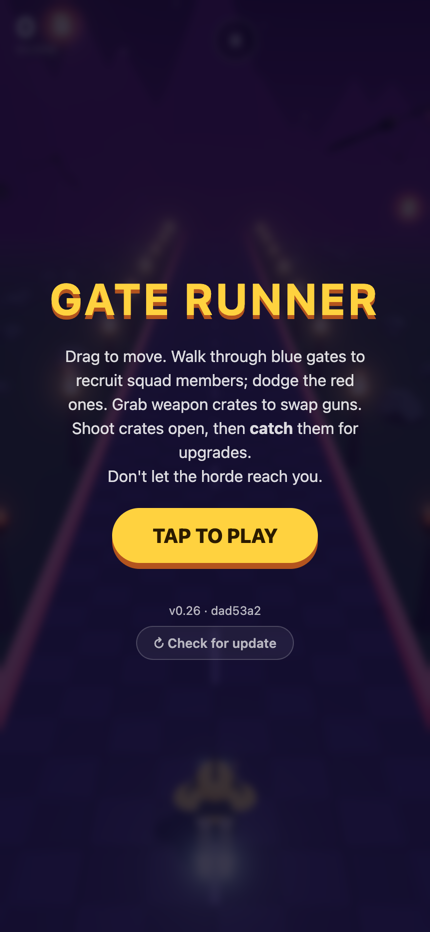
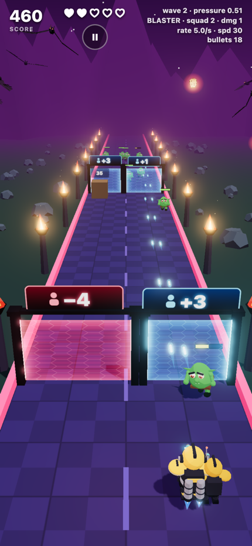
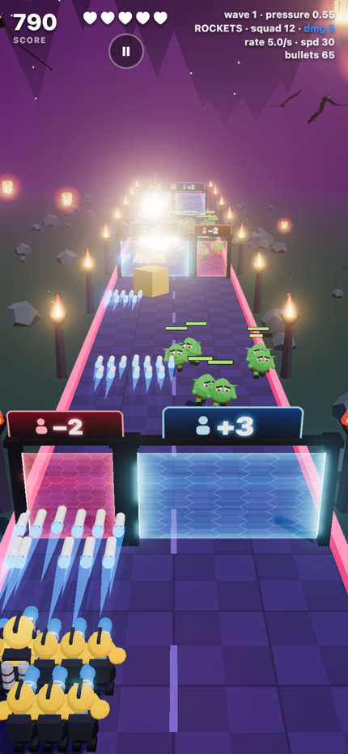
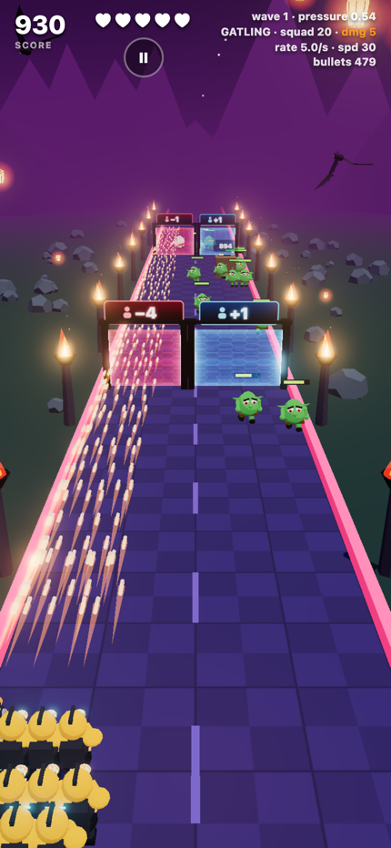
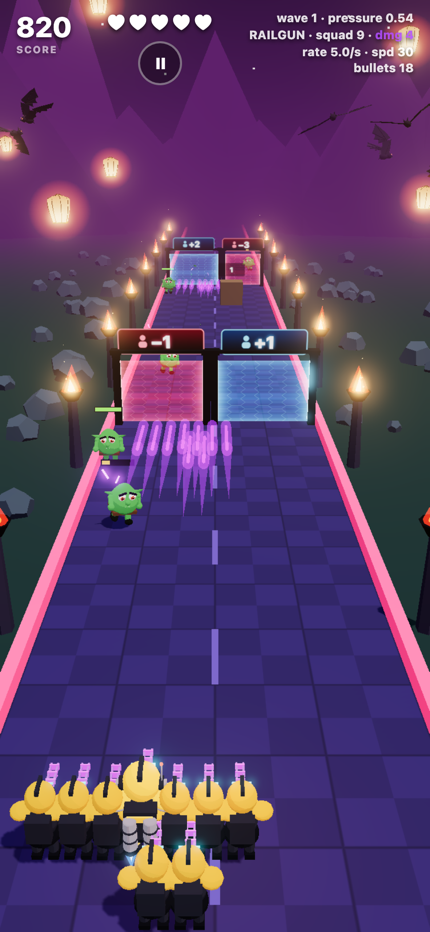

# Gate Runner

**A 3D mobile arcade shooter that installs from the browser, with no App Store involved.**

Lead a growing squad of troopers down a haunted road, choose which energy gates to run through, shoot open upgrade crates, swap weapons, and hold back a horde that adapts to how well you're playing.

▶ **Play it:** https://gate-runner-five.vercel.app. On a phone, open it in Safari or Chrome and choose **Add to Home Screen**. It then runs fullscreen and offline like a native app.

<p align="center">
  
  
  
  
  
</p>

---

## Why this exists

This started as one question: *we already use PWAs to ship app-like experiences without app stores, so could we do the same for mobile games?*

Plenty of mobile games in the "gate runner" genre are buried under ads. The goal was to build an original take on the genre, ad-free, as a learning project. It also tests how far a browser game can go on a phone: real 3D, hundreds of animated characters, post-processing, and offline install.

The answer: **a long way.** The whole game is one static site deployed to Vercel, with no native code, no store review and no install friction.

## How it plays

- **Drag** anywhere to move your trooper left and right. Your squad follows in formation.
- **Gates** come toward you in pairs. Blue gates recruit troopers (**+1 to +3**), red ones take them away. The split point moves from row to row, so you have to steer through it.
- **Everyone fires.** Squad members carry your current weapon. An enemy shot that hits an ally takes them out instead of costing you a heart.
- **Crates** soak up your bullets until they open, then you have to **catch** them:

  | Crate | Effect |
  |---|---|
  | RATE+ / SPD+ | Fire rate or projectile speed |
  | DMG+ | Damage, shown as **loot-style colour tiers** on every shot and gun (green → blue → purple → orange → red) |
  | ALLY+ | A permanent extra squad member |
  | +♥ | A heart back (rare, only when you're hurt) |
  | Weapon | Swap your whole squad's weapon |

- **Weapons** trade fire rate against damage per hit:

  | Weapon | Fire rate | Damage | Special |
  |---|---|---|---|
  | Blaster | 1× | 1× | Reliable all-rounder |
  | Gatling | 2.6× | 0.42× | Spinning barrels, tracer storm |
  | Rockets | 0.32× | 2.4× | Area damage, explosions, camera shake |
  | Railgun | 0.42× | 2.6× | Pierces every enemy in a line |

- **The horde**: seven enemy types, from swarming goblins to bat-winged demons, armoured ogres and a crowned warlord boss every fifth wave. The bigger ones fire slow, glowing orbs you have to dodge.

**Showcase mode:** start a run already loaded up via the URL, e.g. [`?weapon=rocket&squad=12&dmg=3`](https://gate-runner-five.vercel.app/?weapon=rocket&squad=12&dmg=3) or [`?weapon=gatling&squad=20&dmg=5`](https://gate-runner-five.vercel.app/?weapon=gatling&squad=20&dmg=5).

## Tech stack

| | |
|---|---|
| **Rendering** | [Three.js](https://threejs.org) 0.187, WebGL with instancing, a custom GLSL shader for the gate fields, and an `EffectComposer` bloom pass |
| **Language / build** | TypeScript 7, Vite 8 |
| **PWA** | `vite-plugin-pwa` (Workbox): fullscreen manifest, offline cache, controlled auto-updates |
| **Hosting** | Vercel, auto-deploying from `main` |
| **Art** | **None downloaded.** Every character, prop and effect is generated in code from primitive shapes |

There are no other runtime dependencies: no game engine, no physics library, no UI framework.

## Architecture

```
src/
  main.ts     Game loop, state, input, HUD, spawning, collisions, difficulty director
  models.ts   Geometry toolkit (merge primitives with vertex colours) + the 7 enemy designs
  hero.ts     Player character, swappable weapon, squad renderer, per-weapon projectiles
  weapons.ts  Weapon stats and gun models
  gates.ts    Gate archways + animated energy-field shader
  fx.ts       Pooled effects: spawn portals, explosions, sparks, floating text, camera shake
  env.ts      Scenery: flaming braziers, mountains, ringed moon, bats, sky lanterns, airship
```

### How it stays fast on a phone

- **Everything that repeats is instanced.** Each enemy type is split into instancable parts (tinted body, untinted accents, two legs, two arms), so hundreds of animated characters cost a few draw calls per type. Legs and arms swing through per-instance matrices, which gives running animation without skeletal skinning.
- **Procedural models merged into single geometries** with vertex colours, cel-shaded with a 3-step `MeshToonMaterial` ramp.
- **Detail where it counts.** The player is about 79k vertices because there's only one. Enemies were cut from about 9k to about 5k vertices each once the vertex budget was measured, and shadows are only cast by bodies and legs.
- **Bloom at reduced resolution**, with a threshold above 1.0 so only things deliberately made brighter than white glow.
- **No per-frame allocations** in the render loop (scratch objects are reused), and pooled effects.

## Design decisions worth calling out

The game was built in short cycles: build, play on a real phone, give feedback, adjust. These are the problems that turned out to be interesting.

### 1. Difficulty: from stacked multipliers to a "pressure" director

The first few versions ramped difficulty with several independent knobs: bigger packs per wave, faster spawns, more HP per wave, HP following player power, and a "heat" multiplier. Each looked reasonable alone. Together they multiplied: total incoming enemy HP grew about **60×** by wave 10, far faster than any player could, and toning down one knob never helped.

The replacement is a single budget. Every second, the game sends enemy HP equal to **pressure × the player's firepower**:

- **Pressure** starts at 0.5 and levels off toward 0.8 over the waves, so it can never outgrow you.
- **A small performance nudge** (±30%) raises it when you're killing enemies far up the road and drops it on close calls or lost hearts.
- **Firepower** accounts for squad size, weapon, and splash/pierce bonuses.
- **Extra power mostly means *more* enemies, not tankier ones.** Individual HP scales with √firepower, so kills stay snappy.
- **Enemies already on screen keep the HP they spawned with.** Upgrades only affect what comes next.

### 2. "Is this enemy actually killable?"

Scaling HP with *total* firepower broke once the squad got wide: a big enemy is only hit by the troopers lined up behind it. Now every enemy's HP is **capped at N seconds of the damage that can physically reach something its width**: under a second for goblins, about 4 seconds for brutes, and longer for bosses. Crates follow the same rule. This removed the "wave 8 and the crates are impossible" problem.

### 3. Bloom that kept whiting out the screen

The glow effect went wrong three times, each time for a different reason:
1. **Bullets bright enough to glow.** One bullet looked great; hundreds of them saturated the screen.
2. **Glow strength scaled down by bullet count.** That made the glow *pump brighter* whenever bullets hit something and the count dropped.
3. **A threshold that plain white text crossed**, so gate labels glowed.

The fix was to treat glow as an explicit decision. The threshold sits above 1.0, solid bullet centres stay under it, only the low-opacity glow around each shot changes colour with damage tier, and the strength is fixed.

### 4. The PWA reload bug

Players reported being thrown back to "Tap to Play" right after starting. It was the service worker: on each new deploy, the offline setup installs the update in the background and **reloads the page**, often seconds into a run. The update reload is now deferred until you're not mid-run, and the start screen shows the version and commit hash, plus a manual *Check for update* button.

### 5. Squads instead of a wider gun

Early on, gates added bullets to a single gun, which became an ever-wider fan of spray that was hard to control. It moved to straight shots from a widening gun, then to the current design: **gates recruit troopers**, every trooper fires, and weapon crates change *how* the whole squad fights. That turned "more bullets" into a real choice between, say, a gatling squad for swarms and rockets for packed groups.

### 6. Verified code review

A full code review produced nine findings. Each was **checked before fixing**: colour values measured with the actual Three.js colour pipeline, library source read to confirm how bloom resizes itself, and every logic scenario traced. Seven were real as described, two were only partly right (and the fixes reflect that), and none were false. Examples: the squad count could silently exceed its cap, the enemy budget banked a surge while the 400-enemy cap was full, and old weapon geometry was never freed from the GPU.

## Built with an AI pair programmer

This project was built in one long conversation with **[Claude Code](https://claude.com/claude-code)**. The human side brought the game design, played every build on a phone, and gave blunt feedback ("the bats are ugly", "this gets too hard too fast", "the saturation change isn't obvious enough"). Claude wrote the code, deployed each change, and explained the reasoning behind each fix.

A few things that made that loop work:
- **Every push bumps the version** (enforced in [`CLAUDE.md`](CLAUDE.md)), so you can confirm the build on the phone matches what was just shipped.
- **Problems were diagnosed before they were patched.** For example, "enemies walk away from you" turned out to be enemies moving slower than the gates, so they *looked* like they were retreating.
- **Measurements over guesses.** Vertex counts were checked before shipping new models, colours were measured to confirm bloom behaviour, and these screenshots were captured by driving headless Chrome through real gameplay.

## Running locally

```bash
npm install
npm run dev        # http://localhost:5173 (and on your LAN, so you can test on a phone)
npm run build      # type-check + production build into dist/
npm run preview    # serve the production build
```

`npm run icons` regenerates the PNG app icons, which a small script draws without any image libraries.

Note that installing to the home screen and offline play need HTTPS, so test those on a deployed build.

## Status

A playable prototype and portfolio piece, not a commercial product. Possible next steps: sound and music, staged levels with end bosses, unlockable starting weapons, and a balance pass from real play data.
